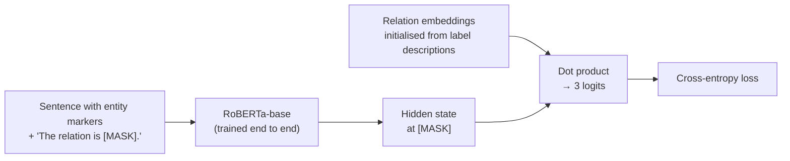

# Causal Relation Extraction: Fine-tuning vs. Prompt-tuning RoBERTa

**Bachelor Final Project · Eindhoven University of Technology · 2026**
Gianluca Cabrera · Supervisor: Mike Holenderski

When labelled data is scarce, should you fine-tune a transformer classifier or reformulate the task as a prompt? This project answers that for **directional causal relation extraction**. It compares a fine-tuned RoBERTa classifier with a KnowPrompt-inspired prompt-tuning model and a Naive Bayes baseline. Training sizes range from 8 examples per class to the full dataset, and the comparison runs on two datasets with 5 seeds each.

### Key results (macro-F1, mean over 5 seeds)

- **SemEval-2010 Task 8:** the prompt model is best with very little data (29.6 vs 9.3 at K = 8; 36.4 vs 21.4 at K = 16) and with all data (**94.3** vs 92.2). Its scores also vary much less across seeds. Fine-tuning leads at K = 32, 64 and 256.
- **CausalNews' (news sentences, multi-word spans):** fine-tuning wins every few-shot setting. Prompt-tuning wins with the full training set (87.7 ± 3.2 vs 74.7 ± 26.7).
- **Span length matters:** both models score lower on sentences with long entity spans. For fine-tuning, the gap widens as the training set grows.

The full report is in [`docs/report.pdf`](docs/report.pdf).

---

## Task

Given a sentence with two marked entities, predict one of three labels:

| Label | Meaning | Illustrative example |
| --- | --- | --- |
| `Cause-Effect(e1,e2)` | the first entity causes the second | `The <e1>fire</e1> caused the <e2>explosion</e2>.` |
| `Cause-Effect(e2,e1)` | the second entity causes the first | `The <e1>explosion</e1> was caused by the <e2>fire</e2>.` |
| `Other` | no causal relation in either direction | `The <e1>fire</e1> started near the <e2>warehouse</e2>.` |

The hard part is direction. The two causal labels contain the same words and differ only in order, so a model has to read the structure of the sentence, not just spot words like *cause*.

## Approach

All three models read the same entity-marked sentence.

| Model | How it predicts | Code |
| --- | --- | --- |
| **Naive Bayes baseline** | Bag-of-words features from each entity span and a two-word window on either side, prefixed by role (`e1_l:`, `e1:`, `e1_r:`, …) so that direction survives. Multinomial Naive Bayes with Laplace smoothing. | [`baseline.py`](src/models/baseline.py) |
| **Fine-tuned RoBERTa** | `roberta-base` with a linear classification head. Entity markers are added as special tokens. | [`roberta.py`](src/models/roberta.py) |
| **Prompt-tuned RoBERTa** (KnowPrompt-inspired) | Appends `The relation is [MASK].` and scores the hidden state at `[MASK]` against three learned relation embeddings. | [`knowprompt.py`](src/models/knowprompt.py) |

### The prompt-tuning model



[KnowPrompt](https://arxiv.org/abs/2104.07650) initialises its answer words and entity-type tokens from label and type words. Here, both causal labels share the same words, so that initialisation would give the two directions almost identical starting vectors. The model therefore makes two changes:

1. **Relation embeddings come from natural-language descriptions.** Each label gets a one-sentence description, for example *"the first entity causes or produces the second entity"*. The description is encoded with RoBERTa and mean-pooled into one vector per relation. These vectors are trained jointly with the model, with their own learning rate.
2. **Entity markers come from role words, not causal roles.** `<e1>` starts as the average embedding of *start, first, entity*, and `</e2>` as *end, second, entity*. Either entity can be the cause, so fixed *cause* or *effect* types would add noise.

## Datasets

| Dataset | Source | Train | Test | `Cause-Effect(e1,e2)` | `Cause-Effect(e2,e1)` | `Other` |
| --- | --- | ---: | ---: | ---: | ---: | ---: |
| SemEval-2010 Task 8 | Hugging Face [`SemEvalWorkshop/sem_eval_2010_task_8`](https://huggingface.co/datasets/SemEvalWorkshop/sem_eval_2010_task_8); all 17 non-causal labels (16 directed relations plus `Other`) are mapped to `Other` | 8,000 | 2,717 | 478 | 853 | 9,386 |
| CausalNews' | Built for this project from the [Causal News Corpus](https://github.com/tanfiona/CausalNewsCorpus) V2, Subtask 2; stored in [`src/data/datasets/`](src/data/datasets/) | 2,023 | 219 | 391 | 1,418 | 433 |

Class counts are over train and test combined.

**How CausalNews' was built** (together with the other students in the project group):

- **Causal examples:** the corpus's cause and effect spans were converted to SemEval-style markers. A cause before its effect gives `Cause-Effect(e1,e2)`; an effect before its cause gives `Cause-Effect(e2,e1)`.
- **Non-causal examples:** the corpus labels non-causal sentences but does not mark entity pairs in them. An LLM proposed event-like span pairs, and three group members reviewed every sentence (accept, edit or reject, decided by majority vote).
- **Clean-up:** malformed markers were corrected manually. The loader in [`data.py`](src/data/data.py) also validates every row and skips any with broken tags.

## Experimental setup

- **Training sizes:** K ∈ {8, 16, 32, 64, 128, 256} examples per class, sampled with a fixed seed, plus the full training set. The baseline is run on the full set only, because its bag-of-words features become too sparse with a handful of examples.
- **Seeds:** 42–46. Each seed controls both the K-shot sample and training randomness. Results are reported as mean ± standard deviation.
- **Metric:** macro-F1, which weights each class equally despite heavy class imbalance.
- **Span-length analysis:** the CausalNews' test set is split at the median of each sentence's longest entity span (12 words): 112 short and 107 long sentences. Both neural models are trained again for this analysis and evaluated on each subset.
- **Shared hyperparameters:** `roberta-base`, 5 epochs, effective batch size 16 (4 × 4 gradient accumulation), AdamW with linear decay, fp16 mixed precision.
- **Learning rates by K** (8 → full): backbone 1e-5, 2e-5, 3e-5, 3e-5, 5e-5, 5e-5, 5e-5 (following KnowPrompt); prompt-model relation embeddings 1e-4, 1e-4, 1e-4, 2e-4, 2e-4, 2e-4, 2e-4. All values are in [`run_all.py`](run_all.py).
- **Hardware:** NVIDIA RTX A1000 Laptop GPU, Intel i7-12700H.

## Results

Macro-F1 (%), mean ± standard deviation over 5 seeds. Best score per column in bold.

### Main results

| Dataset | Model | K=8 | K=16 | K=32 | K=64 | K=128 | K=256 | Full |
| --- | --- | ---: | ---: | ---: | ---: | ---: | ---: | ---: |
| SemEval | Naive Bayes | – | – | – | – | – | – | 56.0 |
| SemEval | Fine-tuning | 9.3 ± 12.3 | 21.4 ± 14.2 | **38.9 ± 16.6** | **63.6 ± 8.2** | 62.7 ± 33.5 | **79.0 ± 3.8** | 92.2 ± 3.7 |
| SemEval | Prompt-tuning | **29.6 ± 1.9** | **36.4 ± 4.0** | 36.0 ± 3.4 | 56.1 ± 1.4 | **73.3 ± 2.6** | 78.5 ± 1.8 | **94.3 ± 0.7** |
| CausalNews' | Naive Bayes | – | – | – | – | – | – | 67.7 |
| CausalNews' | Fine-tuning | **16.2 ± 10.1** | **18.3 ± 11.2** | **39.6 ± 3.7** | **53.5 ± 3.3** | **69.7 ± 7.9** | **74.0 ± 14.7** | 74.7 ± 26.7 |
| CausalNews' | Prompt-tuning | 10.1 ± 2.6 | 16.4 ± 0.8 | 18.5 ± 4.6 | 45.0 ± 3.3 | 54.3 ± 6.4 | 66.2 ± 9.5 | **87.7 ± 3.2** |

The baseline is deterministic, so it has no spread across seeds. Its macro-F1 is computed over the two causal classes only (the SemEval convention), while the neural models' macro-F1 includes `Other`. The baseline row is therefore a rough reference point, not a like-for-like comparison.

### CausalNews': short vs. long entity spans

| Model | Spans | K=8 | K=16 | K=32 | K=64 | K=128 | K=256 | Full |
| --- | --- | ---: | ---: | ---: | ---: | ---: | ---: | ---: |
| Fine-tuning | Short | **16.3 ± 7.3** | 19.1 ± 9.4 | **39.8 ± 5.3** | **53.1 ± 4.1** | **71.4 ± 4.3** | **78.8 ± 10.3** | 84.3 ± 2.8 |
| Fine-tuning | Long | 15.7 ± 13.5 | 16.3 ± 12.9 | 31.3 ± 6.1 | 41.3 ± 5.6 | 60.2 ± 8.3 | 61.4 ± 4.9 | 68.2 ± 10.3 |
| Prompt-tuning | Short | 15.7 ± 2.7 | **20.0 ± 5.5** | 22.6 ± 7.2 | 46.6 ± 2.5 | 57.2 ± 4.7 | 69.3 ± 8.8 | **87.8 ± 2.1** |
| Prompt-tuning | Long | 2.6 ± 1.6 | 7.8 ± 2.0 | 12.3 ± 2.6 | 36.4 ± 2.6 | 39.5 ± 9.1 | 52.8 ± 7.7 | 71.0 ± 6.0 |

### What the results suggest

- **The prompt formulation helps most at the extremes on SemEval.** With 8–16 examples per class, the description-initialised relation embeddings give the model a useful starting point that a randomly initialised classification head lacks. With the full data, they still give the best score and the lowest variance.
- **Fine-tuning is less stable but adapts to the data more directly.** It has high variance in several few-shot settings (e.g. ±33.5 at K = 128 on SemEval). On CausalNews', it beats the prompt model at every K up to 256, probably because it learns dataset-specific patterns directly instead of relying on hand-written relation descriptions.
- **Dataset structure changes the picture.** CausalNews' has long, event-like spans and a different class balance from SemEval, and both neural models score lower on it in most settings.

## Limitations

- **No ablation.** The contribution of each prompt component (descriptions, marker initialisation, template) is not isolated.
- **The `Other` class in CausalNews' was LLM-proposed and then peer-reviewed.** It may differ in style from the original corpus annotations.
- **The datasets differ in domain, span length and class balance,** so differences between them mix model effects with data effects.
- **Span length and class are partly confounded.** In CausalNews', `Other` examples have shorter marked spans (median longest span of 7 words, vs 12–13 for causal examples in training). As a result, 30 of the 34 `Other` test sentences fall in the short subset, so the span analysis partly reflects class composition.

## Repository structure

```text
.
├── run_all.py                    # experiment runner: datasets × K × seeds × models
├── environment.yml               # pinned conda environment
├── Dockerfile                    # reproducible container (micromamba)
└── src
    ├── data
    │   ├── data.py               # loads SemEval (Hugging Face) and CausalNews' (local), maps labels to 3 classes
    │   ├── generate_k_shot.py    # seeded K-per-class sampler
    │   ├── span_splits.py        # short/long split by longest entity span
    │   └── datasets/             # CausalNews' train (train_clean.txt) and test (dev_clean.txt)
    ├── models
    │   ├── baseline.py           # Multinomial Naive Bayes
    │   ├── roberta.py            # fine-tuned RoBERTa (Hugging Face Trainer)
    │   ├── knowprompt.py         # prompt-tuned RoBERTa (custom PyTorch training loop)
    │   └── aggregate_results.py  # mean ± std per model, dataset, K and subset
    └── utils
        └── experiment_logging.py # local CSV logging, optional Weights & Biases
```

### Implementation notes

- The prompt model uses a custom PyTorch loop: it finds the `[MASK]` position, uses two parameter groups with separate learning rates, and adds gradient accumulation and mixed precision.
- `run_all.py` launches every run in a fresh subprocess, so GPU memory is released between runs.
- Results are appended to a local CSV. Weights & Biases logging is optional and fails gracefully, so nothing depends on an external account.
- The Docker image and `environment.yml` pin every package version.

## Reproducing the experiments

**Requirements:** a CUDA GPU (the fine-tuning script trains in fp16, which needs one) and internet access on the first run to download `roberta-base` and SemEval from the Hugging Face Hub.

### With conda

```bash
conda env create -f environment.yml
conda activate causal

# full replication: SemEval, CausalNews', and the span-length analysis
python run_all.py --suite replication --overwrite_results

# aggregate into mean ± std per setting
python src/models/aggregate_results.py \
  --local_file results/local_results.csv \
  --output results/local_aggregated_results.csv
```

The full suite trains 210 transformer models (3 experiments × 7 training sizes × 5 seeds × 2 models), plus 10 baseline runs. Results are written to `results/local_results.csv`.

To run a single configuration, run the model script from the repository root with `PYTHONPATH` set:

```bash
PYTHONPATH=. python src/models/knowprompt.py --dataset semeval --k 16 --seed 42 --lr1 1e-4 --lr2 2e-5 --no_wandb
PYTHONPATH=. python src/models/baseline.py --dataset causalnews --no_wandb
```

To also log to Weights & Biases, add `--use_wandb` to `run_all.py`.

### With Docker

```bash
docker build -t causal-re .

# full replication suite, results written back to ./results
docker run --rm --gpus all \
  -v "$PWD/results:/app/results" \
  -v "$HOME/.cache/huggingface:/home/mambauser/.cache/huggingface" \
  causal-re

# one dataset only
docker run --rm --gpus all -v "$PWD/results:/app/results" causal-re \
  python run_all.py --suite single --dataset causalnews --overwrite_results --no_wandb

# aggregate inside the container
docker run --rm -v "$PWD/results:/app/results" causal-re \
  python src/models/aggregate_results.py \
    --local_file results/local_results.csv \
    --output results/local_aggregated_results.csv
```

`--gpus all` requires the NVIDIA Container Toolkit. The second `-v` flag reuses your local Hugging Face cache, so models and data are not downloaded again.

## Acknowledgements

Supervised by Mike Holenderski at Eindhoven University of Technology. CausalNews' was annotated together with the other students in the Bachelor Final Project group.

## References

- Liu et al. (2019). [RoBERTa: A Robustly Optimized BERT Pretraining Approach](https://arxiv.org/abs/1907.11692).
- Chen et al. (2022). [KnowPrompt: Knowledge-aware Prompt-tuning with Synergistic Optimization for Relation Extraction](https://arxiv.org/abs/2104.07650). *The ACM Web Conference 2022.*
- Hendrickx et al. (2010). [SemEval-2010 Task 8: Multi-Way Classification of Semantic Relations Between Pairs of Nominals](https://aclanthology.org/S10-1006). *SemEval 2010.*
- Tan et al. (2022). [The Causal News Corpus: Annotating Causal Relations in Event Sentences from News](https://aclanthology.org/2022.lrec-1.246). *LREC 2022.*
